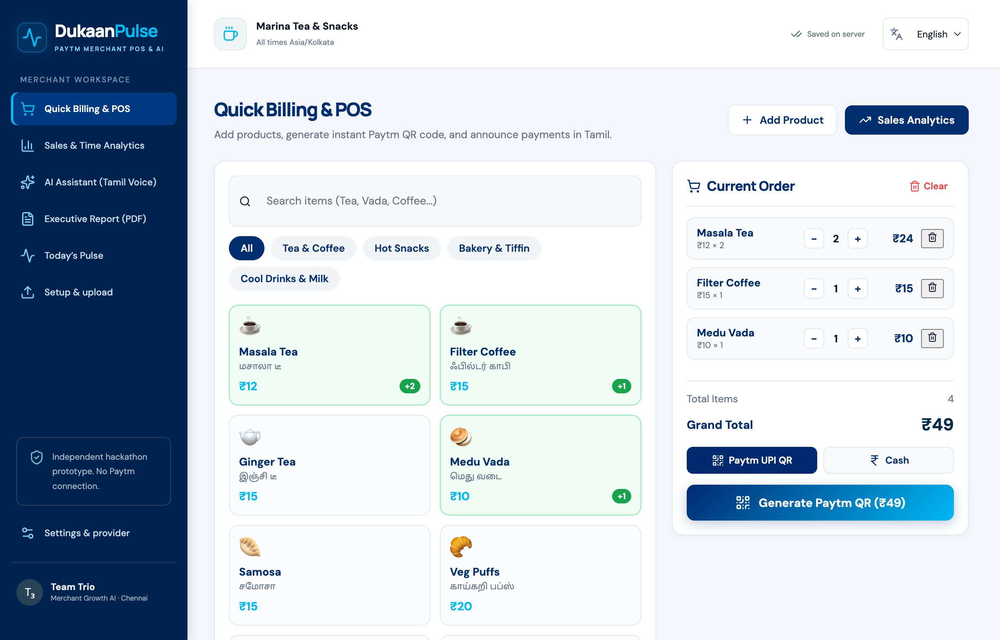
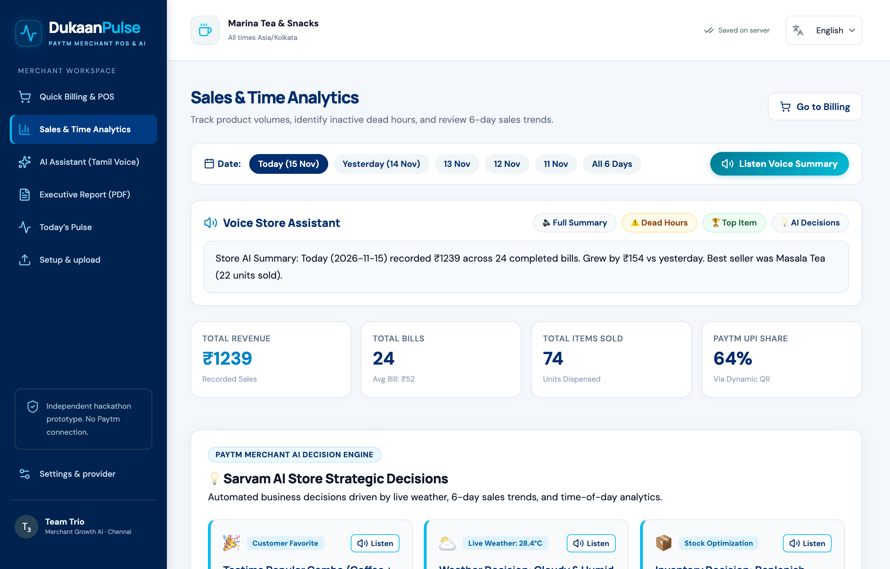
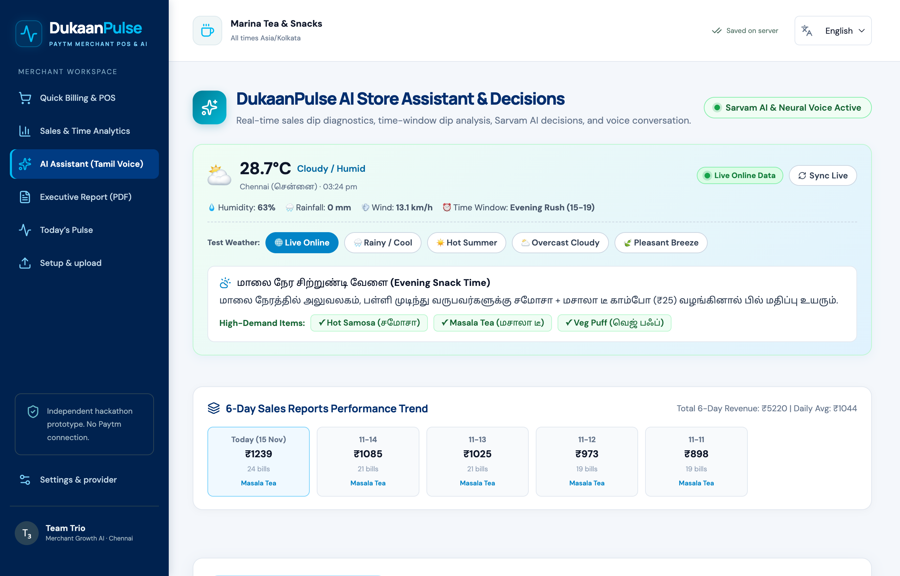
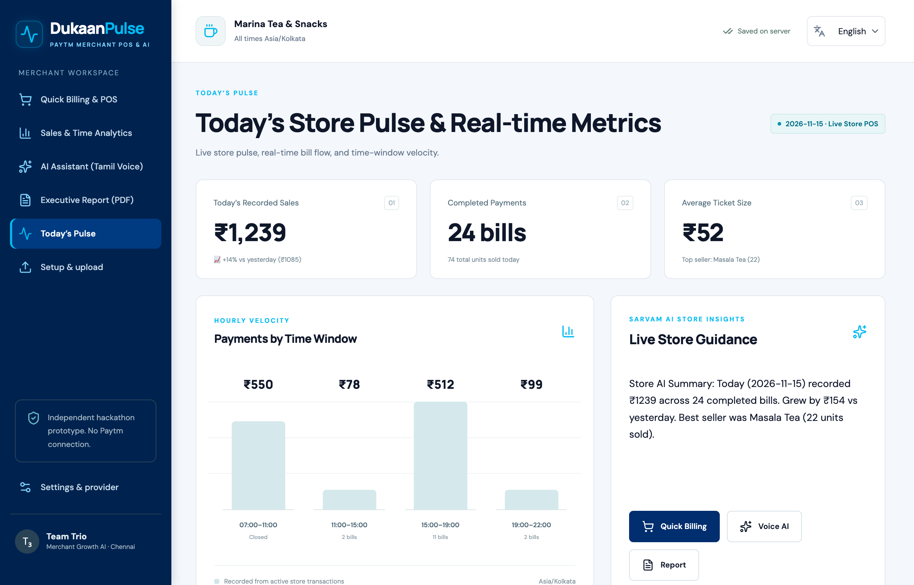
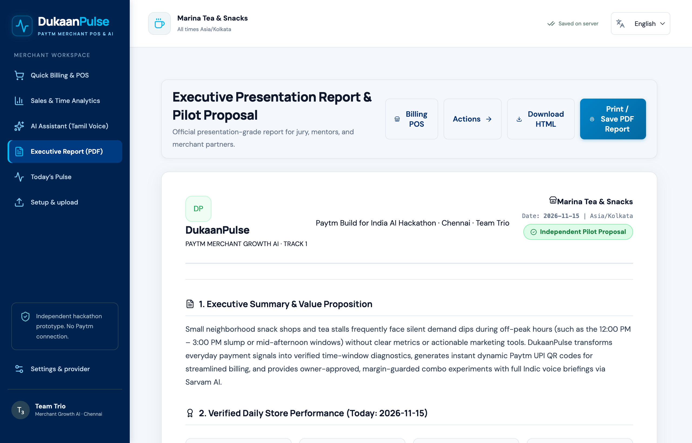
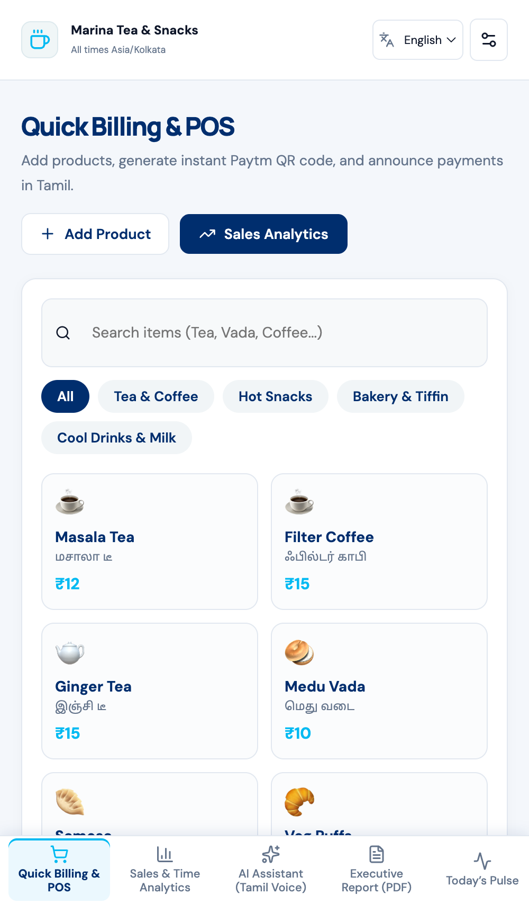

# DukaanPulse (துக்கான் பல்ஸ்)

**Indic AI-Powered POS, Dynamic UPI Standee & Retail Growth Engine for Indian Merchants**

> **Paytm Build for India AI Hackathon · Chennai · Track 1: Merchant Growth AI**  
> *Developed by Team Trio*

---

## 📌 Overview

**DukaanPulse** is an intelligent, voice-first retail POS and growth telemetry application designed specifically for neighbourhood merchants—tea stalls, bakeries, tiffin centers, and small retail shops across India.

It transforms everyday payment patterns and counter checkout into actionable growth decisions using **Sarvam AI (105B Reasoning, Bulbul:v3 Neural Speech, Saaras:v3 Indic STT)**, **live Open-Meteo climate telemetry**, and an **authentic Paytm Soundbox chime recreation**.

```
   ┌──────────────────────────────────────────────────────────────┐
   │                       DukaanPulse POS                        │
   ├───────────────┬──────────────────────────────┬───────────────┤
   │ Quick Billing │ Paytm Soundbox & Dynamic QR  │ Tamil & Hindi │
   │ & POS Counter │ (Harmonic Web Audio + Voice) │ Voice AI (STT)│
   ├───────────────┼──────────────────────────────┼───────────────┤
   │ Hourly Slump  │  Live Weather Demand Engine  │ Executive PDF │
   │  Diagnostics  │   (Open-Meteo Climate Sync)  │ Ready Reports │
   └───────────────┴──────────────────────────────┴───────────────┘
```

---

## 📸 Visual Showcase & Screenshots

### 1. Quick Billing & Fast POS Counter
Fast-paced touch and keyboard billing with item categories (Tea & Coffee, Hot Snacks, Bakery, Cold Drinks).


### 2. Paytm Soundbox & Dynamic UPI QR Code Standee
Generates instant transaction-specific UPI QR codes with authentic multi-harmonic Paytm Soundbox chime and multilingual voice announcement.


### 3. Sales & Time-Window Analytics (Quiet-Hour Diagnostics)
Tracks sales velocity across four retail time windows (Morning Rush, Afternoon Slump, Evening Peak, Night Closing), strictly guarded by store operating hours and payment coverage.


### 4. Sarvam AI Multilingual Assistant & Live Weather Demand
Hands-free Tamil, Hindi, and English voice interaction powered by Sarvam AI and live climate telemetry from Open-Meteo.


### 5. Today's Pulse (Real-Time Store Health)
Live revenue telemetry, average ticket size, and real-time hourly bill velocity without needing synthetic file uploads.


### 6. Executive Report (PDF & Print Ready)
Comprehensive executive summary, diagnostic breakdown, and menu performance ready for 1-click PDF download or printing.


### 7. Responsive Mobile View
Optimized for mobile viewports (tested on 393px iOS/Android devices) with accessible action grids and responsive tables.


---

## ✨ Key Features

### 🛒 1. Fast Counter Billing & Menu POS
- Multi-category menu optimized for Indian retail (`Tea & Coffee`, `Hot Snacks`, `Bakery & Tiffin`, `Cold Drinks & Milk`).
- Rapid item additions, custom items with Tamil/Hindi names, quantity controls, and live cart calculation.
- Stored locally in `localStorage` and synchronized across tabs.

### 🔊 2. Authentic Paytm Soundbox Chime & Voice Confirmation
- **Physical Speaker Emulation**: Recreates the authentic Paytm Soundbox payment confirmation chime using Web Audio API:
  - Ascending two-tone signature chime: **C6 (1046 Hz) $\rightarrow$ E6 (1318 Hz)**.
  - Multi-harmonic overtone synthesis (fundamental, octave harmonic, fifth harmonic, warm triangle body).
  - Accurate ADSR envelope (snappy attack, sustained ring, and exponential release).
  - Stereo impulse convolution reverb for realistic metallic casing resonance.
- **Multilingual Voice Announcements**: Instant neural spoken readout in Tamil (`ta-IN`), Hindi (`hi-IN`), or English (`en-IN`) via Sarvam `bulbul:v3` or browser Web Speech.

### ⏱️ 3. Guarded Quiet-Hour Slump Diagnostics
- Analyzes hourly velocity across standard retail windows:
  - **07:00 – 11:00**: Morning Rush
  - **11:00 – 15:00**: Afternoon Slump
  - **15:00 – 19:00**: Evening Peak
  - **19:00 – 22:00**: Night Closing
- **Store Hours & Coverage Guardrails**:
  - Automatically verifies store opening hours (`context.open`, `context.close`), date exceptions, and payment coverage (`coverage[date]`).
  - If the store was closed during a window or payment coverage is unconfirmed, discount offers are **safely withheld** to prevent unprofitable promotions.

### 🤖 4. Sarvam AI Indic Intelligence & Live Weather
- **Sarvam-105b Reasoning**: Contextual retail business decision engine providing targeted combo offers, inventory adjustments, and pricing guidance grounded in store telemetry.
- **Sarvam Bulbul:v3 Neural TTS**: Colloquial Indic voice output using natural speakers (`kavitha` for Tamil, `priya` for Hindi, `kavya` for English).
- **Sarvam Saaras:v3 Indic STT**: Hands-free voice speech-to-text allowing busy merchants to ask questions naturally while attending customers.
- **Open-Meteo Live Climate Integration**: Fetches real-time temperature, humidity, and weather conditions for Chennai (or the merchant's city) to forecast immediate hot/cold item demand.

### 📊 5. Today's Pulse & Executive Report
- **Live Pulse**: Live revenue counter, completed payment tally, average ticket size, and time-window velocity connected to active checkout data.
- **Executive PDF Report**: Clean white-label report layout with day-over-day KPI cards, hourly diagnostics table, menu profitability rankings, and 1-click print/PDF export.

---

## 🛠️ Architecture & Tech Stack

```
DukaanPulse/
├── app/
│   ├── api/
│   │   ├── ai-chat/route.ts      # Sarvam-105b chat completions with local fallback
│   │   ├── ai-tts/route.ts       # Sarvam bulbul:v3 neural speech synthesis
│   │   ├── ai-stt/route.ts       # Sarvam saaras:v3 speech-to-text
│   │   ├── config-sarvam/route.ts# Key configuration (D1 DB + memory)
│   │   ├── health/route.ts       # Provider health check & live verification
│   │   └── state/route.ts        # D1 / SQLite workspace state persistence
│   ├── billing-components.tsx    # POS Counter, Paytm QR modal & Soundbox
│   ├── ai-assistant-component.tsx# Sarvam AI chat, voice UI & weather guide
│   ├── presentation-report-component.tsx # Executive Report & PDF view
│   ├── workspace.tsx             # Main merchant shell & Today's Pulse
│   └── globals.css               # Responsive design & Paytm Merchant styling
├── lib/
│   ├── ai-assistant.ts           # Multi-day analytics & quiet-hour diagnostics
│   ├── billing.ts                # Cart calculations & authentic Paytm chime
│   ├── weather.ts                # Open-Meteo weather integration & demand advice
│   └── server.ts                 # SQLite fallback & Cloudflare D1 adapter
└── tests/
    ├── ai-assistant.test.ts      # Analytics, quiet-hour guardrails & voice tests
    ├── billing.test.ts           # Billing, UPI URL & sales analytics tests
    └── analytics.test.ts         # CSV validation & economics guardrails
```

- **Frontend & Fullstack**: Next.js 16 (App Router), React 19, TypeScript, Lucide Icons.
- **Styling**: Responsive CSS3 with custom properties, media queries for mobile/desktop, and print-media stylesheets for PDF generation.
- **Persistence**: Cloudflare D1-compatible SQLite (`node:sqlite` local adapter with in-memory map fallback).
- **Validation**: Strict Zod schemas for context, mutations, and domain commands.

---

## 🚀 Quick Start & Local Setup

### Prerequisites
- Node.js `>=20.0.0` (tested on Node 22 & Node 24)
- npm or pnpm

### 1. Clone & Install
```bash
git clone https://github.com/poova-dev/DukaanPulse.git
cd DukaanPulse
npm install
```

### 2. Configure Environment (Optional)
To enable live Sarvam AI neural speech and reasoning, create a `.dev.vars` file in the project root:
```bash
SARVAM_API_KEY="your_sarvam_api_key_here"
```
*(If omitted, DukaanPulse runs seamlessly using local Indic intelligence and browser Web Speech.)*

### 3. Run Development Server
```bash
npm run dev
```
Open [http://localhost:5173](http://localhost:5173) in your browser.

### 4. Run Test Suite & Typecheck
```bash
# Run unit & regression tests (41 tests)
npm test

# Verify TypeScript types
npm run typecheck

# Production build
npm run build
```

---

## 🧪 Test Coverage & Verification

DukaanPulse includes an extensive automated test suite covering 41 unit and regression tests:
- **`tests/ai-assistant.test.ts`**:
  - Store operating hours and date exception verification (closed store withdraws quiet-hour advice).
  - Payment data coverage checks (unconfirmed coverage prevents false slumps).
  - Multilingual AI Q&A across Tamil (`ta-IN`), Hindi (`hi-IN`), and English (`en-IN`).
  - Day-over-day dip calculations and time-window dip thresholds.
- **`tests/billing.test.ts`**:
  - Paytm UPI URL format compliance (`upi://pay?pa=...&am=...`).
  - Authentic Paytm Soundbox audio generation parameters.
  - Multi-day product sales and inactive hour calculations.
- **`tests/analytics.test.ts`**:
  - CSV parsing, deduplication, conflicting ID rejection, and timestamp parsing.
  - Contribution margins, stock limits, and budget floor protection.

---

## ⚖️ Hackathon Disclosure & Honest Limits

- **Independent Prototype**: Built for the *Paytm Build for India AI Hackathon (Chennai)*. This is an independent hackathon prototype and is not affiliated with or endorsed by One97 Communications / Paytm.
- **Standard UPI QR Code**: The dynamic QR code is a standard interoperable UPI QR format (`upi://pay`) compatible with all Indian payment apps (Paytm, BHIM, Google Pay, PhonePe).
- **Simulated Demonstration Data**: Out-of-the-box multi-day records represent simulated seed data designed to showcase real-world retail analytics from the moment the app opens.
- **Sarvam AI Verification**: Live calls to `sarvam-105b-conversations`, `bulbul:v3`, and `saaras:v3` run server-side. If no API key is provided, DukaanPulse transparently defaults to local Indic fallback responses without failing.

---

## 👥 Team Trio

- Developed with ❤️ for Indian neighbourhood merchants at the **Paytm Build for India AI Hackathon (Chennai)**.
